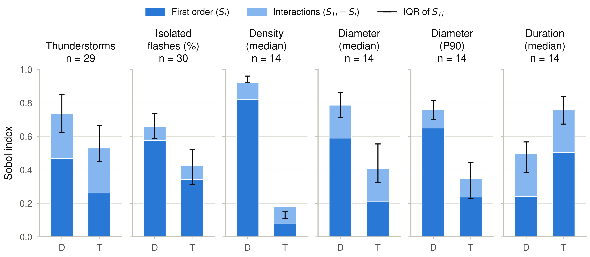

Sobol indices chart
===================

One figure for the Sobol indices of an algorithm's sweep: for each KPI, a panel with one
bar per parameter, its first-order index at the bottom, what its interactions add on
top (the whole bar is its total index), and a whisker over the interquartile range of
the total index across the episodes. It draws the summary file of
:doc:`sobol_indices`, of any algorithm, as a PNG, 16 cm wide at 600 dpi, in English or
Catalan, and writes the same numbers as a Word table: per KPI, ``n`` and the median
(q1–q3) of each parameter's total index and of each pair's interaction.

The time-distance clustering over FMI's first quarter of Finland's episodes (lightning
data: Finnish Meteorological Institute, open data, CC BY 4.0):

         duration), each with a bar for D and one for T. D's total index is the larger
         for all but the duration, where T's is.

.. contents::
   :local:
   :depth: 1

.. automodule:: gisfire_experiments.thunderstorms.sobol_chart
   :members:
