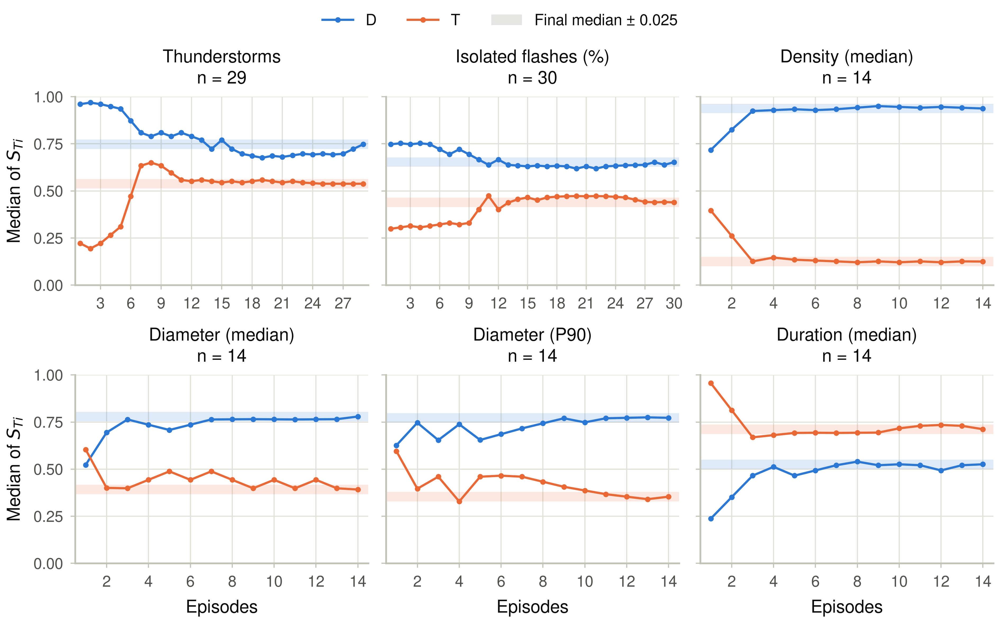

Sobol indices convergence
=========================

Whether there are episodes enough for the medians of :doc:`sobol_chart`: for each KPI, a
panel with the running median of each parameter's total index as the episodes are
taken one after the other, in the file's order, and a pale band at its last value
± 0.025. It draws the per-episode file of :doc:`sobol_indices`, of any algorithm, as a
PNG, 16 cm wide at 600 dpi, in English or Catalan.

The time-distance clustering over FMI's first quarter of Finland's episodes (lightning
data: Finnish Meteorological Institute, open data, CC BY 4.0):

         duration), each with a curve for D and one for T. The curves swing over the
         first episodes; the density's stay inside the band at their last value from
         the third episode, the others from later on, the thunderstorm count's D only
         at the last one.

.. contents::
   :local:
   :depth: 1

.. automodule:: gisfire_experiments.thunderstorms.sobol_convergence
   :members:
